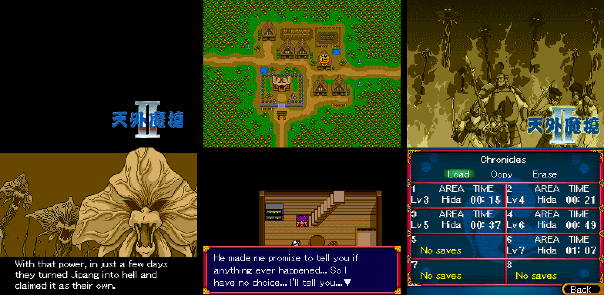

# Far East of Eden II: Manjimaru — English Translation v1.1.0

An English translation patch for **Tengai Makyou II: Manji Maru**, Hudson's
2005 Nintendo DS remake of the 1992 PC Engine CD classic. It was never
released in English, until now.



## Download

Get the zip from the
[v1.1.0 release](https://github.com/ACR-GD/tengai-makyou-2-english/releases/tag/v1.1.0). It contains the BPS patch and a
README. The game is not included: patch your own dump of the Japanese ROM.

| | Size | CRC32 | SHA-1 |
|---|---|---|---|
| Japanese ROM (input) | 134,217,728 | `0DF79A80` | `0717fcc412af42c2b1d7ac9178974e1259fb7c63` |
| English ROM (output) | 136,634,280 | `29B4CA1B` | `f252e5dd42837afaf948fa4eb25ed2b41bf0612c` |

Apply with [Rom Patcher JS](https://www.marcrobledo.com/RomPatcher.js/),
Flips or MultiPatch.

If you played v0.9: it could corrupt the game's memory after long
conversations (sudden poison, deaths, revivals, level jumps). v1.0.1 and later
fix this, but can't repair a save that was already damaged. Patch the original
Japanese ROM, not an older English ROM.

## What's new in v1.1.0

- No more overlapping text in the act prologues, the boss lines in battle and
  the save/load screen title.
- The opening staff cards are translated.
- Shop gear stats show the right number after At/Df/Sp.
- Scrolls renamed: Young Grass → Leaf, Lightning Flash → Flash. The scroll
  grid in menus and battle no longer runs names together.
- Zipangu is now Jipang.
- Save slots read "Lv3" instead of "3Lv/".

See [CHANGELOG.md](CHANGELOG.md) for earlier versions.

## What's translated

- All 11,661 lines of story and NPC dialogue
- All 189 cutscene subtitles, refitted to the cutscene layouts
- Battles: commands, messages, enemies, items, spells, arts and equipment
- Field menus, shops, inns and storage
- Place names on the menus, the province map and the world map
- Title screen, New/Load menu, save/load screens
- Opening staff cards, staff roll and all in-game artwork lettering
- A new variable-width font

## Tools

The Python tools used to make the patch are in [`tools/`](tools). They need
Python 3.11+ and Pillow (`pip install -r requirements.txt`; `capstone` and
`numpy` only for the analysis scripts). This repository does not contain the
game, files unpacked from it, or the translation data the build reads
(`translation/`). The tools document the formats and techniques, and you can
run them on your own dump.

| Tool | Purpose |
|---|---|
| `nds_extract.py` | Unpack a DS ROM (ARM9/ARM7, overlays, NitroFS files) |
| `build_en_vwf_rom.py` | Full build: scripts, font, names, graphics, BPS patch |
| `bps_patch.py` / `bps_apply.py` | Write a BPS patch / apply one and verify every CRC32 |
| `scs_codec.py`, `scs_build_en.py` | `.scs` dialogue script format and rebuilder |
| `vwf_font.py`, `vwf_arm9.py`, `text_raster.py` | Variable-width font and its ARM9 hooks |
| `ov008_build.py`, `subtitle_layout.py` | Cutscene subtitle text and on-screen positions |
| `native_*.py`, `combat_text.py`, `battle_panel.py` | Relocated menu, battle and name strings |
| `cmp_codec.py` and `*_graphics.py` | `CMP`/LZ10 graphics containers and the repainted UI art |
| `disasm.py`, `ghidra/` | ARM disassembly and Ghidra scripts used for research |

Check a patched ROM yourself:

```sh
python3 tools/bps_apply.py "Japanese.nds" "Tengai Makyou II - Manji Maru (English v1.1.0).bps" "English.nds"
```

It stops on a wrong source ROM, and otherwise writes a ROM that matches the
output CRC32 above.

`docs/VWF.md` describes how the variable-width font works.

## Known issues

- The whole game hasn't been played start to finish on the patched ROM:
  late-game content is verified against the game data and in an emulator.
- Staff names are romanized from the kanji; a few readings may be off.
- A few small menu boxes use short forms (Gear/Item/Scrl, Manji, Gokur., Nxt),
  and the scroll grid shows short scroll names (Leaf, Zap…).
- A few name banners in the anime intro are still in Japanese.
- Tested on melonDS 1.1 and DeSmuME 0.9.12, not yet on real hardware.

Bug reports with screenshots are very welcome: please [open an issue](../../issues).

*Unofficial fan translation, not affiliated with Hudson Soft, Konami or RED.*
