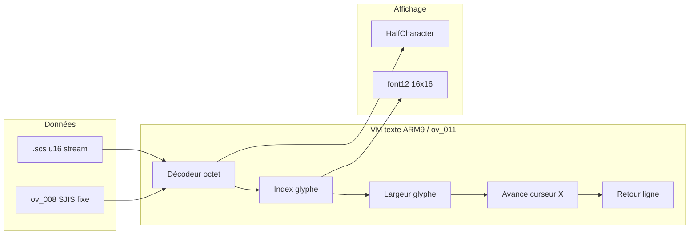

# VWF — police à chasse variable (long terme)

Objectif : afficher l’anglais **complet** (phrases entières, retours à la ligne naturels) sans tronquer au budget « nombre de kanas » du japonais.

## Contraintes actuelles (rappel)

| Couche | Comportement | Limite pour l’anglais |
|--------|--------------|------------------------|
| **Données `.scs`** | Flux `u16` : SJIS = 1 glyphe, codes `{0011}` etc. | Réinsertion **en place** = même nombre de **cases** qu’en JP |
| **`ov_008`** | Chaînes SJIS **taille fixe** (ex. 14 cases = 28 octets) | Impossible d’allonger sans déplacer toute la table + patch ARM9 |
| **Moteur** | Lecture **par paires d’octets** ; pas d’ASCII 1 octet en dialogue | `tengai2_EN_ascii.nds` → charabia |
| **Rendu** | Glyphes **16×16** ; avance ≈ **1 cellule pleine (16 px)** par caractère | Pleine-chasse : 1 lettre = 1 case → ~15 lettres / ligne |

La pleine-chasse et les digrammes contournent les **données** ; la VWF attaque le **moteur**.

---

## Ce qu’on sait déjà (ROM `ATMJ`)

### Polices

- `font12_GothicW3_bit.cobj` — dialogue (16×16, 32 o/glyphe, ~7560 glyphes).
- `HalfCharacter_bit.cobj` — demi-chasse (présente, référencée dans l’ARM9 avec `font12`).
- Table SJIS → index : formule dans `tools/sjis_glyph.py` (alignée sur `0x02018D40` ARM9, littéral `0x17A0`).

### Code repéré

| Zone | Rôle probable |
|------|----------------|
| `ARM9` `0x02018D40` | Calcul index glyphe SJIS (`mul` + `lsl #4`) |
| `ARM9` `0x02039730` | Littéral `0x020EB6CC` (table / état police) |
| `ARM9` `~0x020A1DAC` | Noms de fichiers + descripteurs polices |
| Overlay **`ov_011`** | Sous-système texte / police (à désassembler en priorité) |
| **`ov_008`** | Table de chaînes SJIS brutes (prologue, mère) — **autre chemin** que `.scs` |

Il n’existe **pas** de mode « demi-chasse » activable par un simple code `{XXXX}` dans les `.scs` : le VM dialogue ne consomme que des mots SJIS valides.

---

## Architecture cible VWF



**Principe** : `curseur_x += width(glyph)` au lieu de `+= 16` fixe ; le retour à la ligne se fait sur **pixels** (ou demi-cellules), pas sur le nombre de kanas.

---

## Plan en 4 phases

### Phase 1 — Préparer les données (sans ARM9)

- `.scs` : `build_rom_rebuild.py` pour messages **sans pointeur interne** (texte plus long).
- Encodage : pleine-chasse ou digrammes selon ce que le rendu supporte.
- `ov_008` : rester sur abréviations ou digrammes tant que le lecteur `ov_008` n’est pas patché.

*Ne résout pas tout seul la VWF, mais évite de gaspiller de l’espace une fois le moteur prêt.*

### Phase 2 — VWF « largeurs par glyphe » (patch ARM9 modéré)

**Idée** : le jeu a déjà une logique index → métadonnées (indices : `ldrb [r1, #5]` autour de `0x02016Fxx`, tables construites au boot vers `0x0212xxxx`).

1. Désassembler la routine qui fait **`x += width`** après `0x02018D40`.
2. Soit :
   - **patcher une table de largeurs** (7560 entrées `u8` : latin pleine-chasse → `8`, kanji → `16`),  
   - soit **hook** : si index dans plage « latin FFxx », largeur = 8.
3. Ajuster le **wrap** : comparer `x + width` à la largeur de la boîte (souvent ~256 px → ~16 cases × 16).

**Effet** : ~2× plus de lettres par ligne **sans** changer le format `.scs`.

**Outils** : `tools/vwf_scan.py`, `tools/disasm.py`, désassemblage ciblé `ov_011.bin`.

### Phase 3 — Demi-chasse dans le VM (patch plus large)

**Idée** : pour octets `0x20–0x7E` (ou SJIS demi-chasse si mappé) :

- charger **`HalfCharacter`** au lieu de `font12` ;
- consommer **1 octet** (ou 1 mot spécial) au lieu de 2 ;
- avance **8 px**.

Implémentation typique :

- Hook au début de la boucle de lecture du message (`.scs` et éventuellement `ov_008`).
- Drapeau « mode latin » ou détection automatique sur la plage de code.

**Effet** : densité ×2 sur les **octets** + largeurs réduites si phase 2 en plus.

### Phase 4 — Finition

- Retours à la ligne **mot par mot** côté outil (`scs_build_en.py --wrap` en **pixels**, pas en cases).
- Prologue `ov_008` : routine dédiée ou chaînes migrées vers `.scs` si le script l’autorise.
- Menus / UI graphiques : hors scope VWF dialogue (assets pré-rendus).

---

## Stratégie de patch ROM

1. **Trouver** dans `arm9.bin` + `ov_011.bin` : boucle dialogue, `+= 16`, wrap ligne.
2. **Allouer** du code libre (stub dans overlay ou zone `0x02xxxx` déjà utilisée pour tables).
3. **Branch** : `BL` vers helper VWF, retour.
4. **Tester** sur cas fixes :
   - lanterne `wa1/vaa1f2.scs#1` ;
   - mère `ov_008` `0x50D0` ;
   - ligne longue prologue (capture « Even so, child… »).

Émulateur : melonDS + savestate au même écran pour comparer.

---

## Effort estimé

| Phase | Difficulté | Résultat |
|-------|------------|----------|
| 2 — largeurs | Moyenne (1–2 semaines RE) | Phrases ~2× plus longues, lisibles |
| 3 — demi-chasse VM | Élevée | Anglais proche d’un RPG DS localisé |
| 4 — wrap + ov_008 | Moyenne | Couverture quasi complète dialogue |

---

## Pistes à éviter

- **ASCII 1 octet seul** dans le flux actuel → non géré (confirmé en jeu).
- **Agrandir** les champs `ov_008` sans mettre à jour **tous** les offsets ARM9 → crash.
- **VWF uniquement côté police** sans toucher au **compteur de colonnes** du VM → glyphes chevauchés ou wrap incorrect.

---

## Fichiers utiles du repo

- `tools/sjis_glyph.py` — index glyphe
- `tools/font.py` / `font_pairs.py` — édition bitmaps
- `tools/scs_build_en.py` — rebuild variable + wrap (à adapter en pixels)
- `tools/build_en_fullwidth_fit.py` — baseline actuelle
- `translation/ov008_en.json` — traductions overlay

Commande scan (points de patch candidats) :

```bash
python3 tools/vwf_scan.py extracted/__system__/arm9.bin 0x02000000
python3 tools/vwf_scan.py extracted/overlays/ov_011.bin 0x022B6000
```

---

## Phase 2 — implémentée : **vraie VWF (largeur par glyphe)**

Fichiers :
- `tools/vwf_font.py` — redessine les glyphes latins en **chasse étroite calée à gauche** + mesure la largeur px de chaque glyphe.
- `tools/vwf_arm9.py` — hooks ARM9 + **table de largeurs 512 o** + patches des deux chemins de rendu.
- `tools/build_en_vwf_rom.py` — ROM anglaise complète (police VWF + table + `.scs` + `ov_008`).

```bash
python3 tools/build_en_vwf_rom.py \
  "0346 - Tengai Makyou II - Manji Maru (J)(WRG)/0346 - Tengai Makyou II - Manji Maru (J)(WRG).nds" \
  tengai2_EN_vwf.nds
# aperçu de la police étroite (marqueur rouge = avance px) :
python3 tools/vwf_font.py --preview docs/vwf_font_preview.png
```

### Largeur par glyphe (au lieu de 8 px fixe)

- **Police** : chaque glyphe latin pleine-chasse (`Ａ-Ｚ`, `ａ-ｚ`, chiffres, ponctuation) est
  redessiné étroit et calé à gauche dans sa cellule 16×16 (sinon une avance < 16 px ferait
  chevaucher les glyphes pleine-chasse d’origine).
- **Table de largeurs** : 512 octets en zone libre ARM9 (`0x0211D24C`), 2 pages indexées par
  `trail` (SJIS lead `0x81` / `0x82`), défaut `0x10` (pleine-chasse) pour ne pas toucher le japonais.
  Ex. `i=4`, `l=4`, `m=11`, `W=13`, espace=5.
- **Hooks largeur** : lisent le caractère courant, retournent `table[page][trail]`, sinon `16 px`.

### Sites patchés (approche minimale corrigée)

**Vérité terrain** (désassemblage + Ghidra) : le moteur de glyphes actif est `ov_wrapper`
(`0x190D4`, appelé depuis `0x16AE4`/`0x16B38`). `dialog_main` (`0x18960`) **n’a aucun appelant**
(code mort). Dans chaque moteur, la base X de dessin est `uVar18`, avancée une fois par glyphe
par `uVar18 += param_8` (avance de cellule fournie par l’appelant = 16 px). **Le retour à la ligne
est piloté par les données** (`0x000D` insérés par l’outil), pas par un compteur pixel/colonne du
moteur. La seule chose que la VWF doit changer est donc **cette unique instruction d’avance** :

| Site | Original | Patch |
|------|----------|-------|
| `dialog_main 0x18EA4` | `ldrb r1,[sp,#0xe4]` (param_8) → `r5 += r1` | `BL` largeur(char `[sp,#0x18]`)→`r1` |
| `dialog_main 0x19060` | `ldrb r2,[sp,#0xe4]` (param_8) → `r5 += r2` | `BL` largeur(char `[sp,#0x04]`)→`r2` |
| `ov_wrapper 0x1945C` | `ldrb r2,[sp,#0x88]` (param_8) → `r4 += r2` | `BL` largeur(char `[sp,#0x04]`)→`r2` |

> **Régression corrigée** : les révisions précédentes patchaient aussi `cmp sl,#0x10` /
> `cmp fp,#0x10`, `add r1,sl,…`, l’incrément `fp` et un faux « curseur pixel » `[sp,#0x34]`.
> Or `sl`/`fp` sont le **compteur des 16 rangées internes du glyphe** (`uVar15`), pas la position
> du texte — les toucher corrompait le rendu (d’où le texte resté pleine-chasse). De plus l’ancien
> hook largeur lisait `[sp,#0x18]` alors qu’`ov_wrapper` range le caractère courant à `[sp,#0x04]`,
> renvoyant donc une largeur fausse. Ces sites sont désormais **laissés intacts** ; seule l’avance
> réelle (`uVar18 += largeur`) est modifiée.

### Correctif ponctuation (`tools/scs_codec.py`)

L’ancien `enc_char` repliait `'`, `-`, `"`, `~` sur l’**espace** pleine-chasse (`0x8140`) car
leur forme `0xFF00` n’est pas encodable en Shift-JIS — soit **~7400 apostrophes, ~1700 traits
d’union, ~600 guillemets** transformés en espaces. Ils pointent maintenant vers les vrais codes
SJIS pleine-chasse (`’ 0x8166`, `” 0x8168`, `− 0x817C`, `〜 0x8160`), redessinés étroits par la VWF.

## Reverse engineering ARM9 (Ghidra)

Analyse headless de `extracted/__system__/arm9.bin` @ `0x02000000` :

```bash
./tools/ghidra_analyze_arm9.sh          # export sur projet existant
./tools/ghidra_analyze_arm9.sh --import # réimport + analyse (~7 min) + export
```

Export : [`docs/ghidra_arm9_vwf.md`](ghidra_arm9_vwf.md) — décompilation des boucles dialogue / `ov_008`, désassemblage des sites de patch VWF.

| Site Ghidra | Offset fichier | Rôle |
|-------------|----------------|------|
| `dialog_main` `0x02018960` | `0x18960` | Boucle rendu `.scs` |
| `sjis_glyph_index` `0x02018D40` | `0x18D40` | Index glyphe SJIS |
| `ov_wrapper` `0x020190D4` | `0x190D4` | Lecteur `ov_008` / prologue |
| `ov_glyph_advance` `0x02019468` | `0x19468` | `uVar18 (r4) += param_8` — **vraie avance** |
| `ov_row_loop` `0x02019450` | `0x19450` | `cmp fp,#0x10` — boucle 16 rangées (NE PAS toucher) |
| `vwf_hook_arena` `0x0211D188` | `0x11D188` | Hooks largeur W_S1/W_S2 (92 o) |
| `vwf_width_table` `0x0211D1E4` | `0x11D1E4` | Table largeurs par glyphe (512 o) |

**PyGhidra** : le paquet pip échoue sous Python 3.14 (récursion JVM). Pour une session GUI interactive :

```bash
python3 tools/ghidra_pyghidra_arm9.py   # via support/pyghidraRun de Ghidra
```

Variable d’environnement optionnelle : `GHIDRA_INSTALL=/chemin/vers/ghidra`.

Projet local : `ghidra/projects/` (non versionné).

## Limite restante (messages « locked »)

Le moteur n’impose **aucun** plafond de longueur de message (il lit jusqu’au terminateur ;
`Y` est mod 256, pas de compteur de lignes max). Round-trip validé : la table d’offsets `u16`
partitionne **exactement** la région (`2272/2272` fichiers) — chaque offset est un point d’entrée
du VM dialogue.

- **6928 messages** sans pointeur intérieur → réencodés en anglais **longueur variable** (espace plein).
- **4733 messages** ont plusieurs points d’entrée internes (branches de dialogue) → réinsérés
  **en place** (longueur d’octets préservée) pour ne pas casser ces entrées. La VWF leur rend de
  l’espace **visuel** (glyphes étroits) mais pas plus de **caractères** : un vrai déverrouillage
  exigerait une traduction par point d’entrée (hors scope automatisable sûr).
- Seule borne dure : région `< 64 Ko` (offsets `u16`) — `0` débordement constaté.

## Suite recommandée

1. Tester `tengai2_EN_vwf.nds` (lanterne, mère, prologue) — vérifier densité + ponctuation.
2. Ajuster les largeurs/threshold dans `tools/vwf_font.py` si certains glyphes se touchent.
3. Phase 3 : demi-chasse VM + phase 4 : wrap mot à mot **en pixels** côté outils.

Les digrammes restent un **pont** utile pendant la RE VWF ; la VWF est la solution définitive pour **tout** le texte à densité latine normale.
